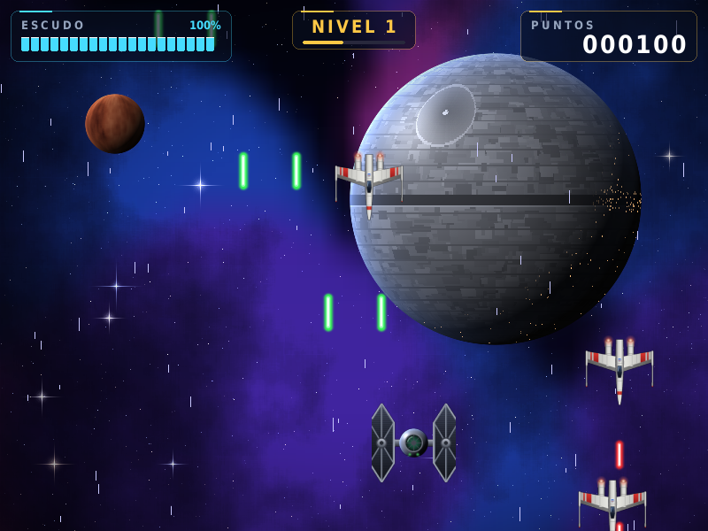
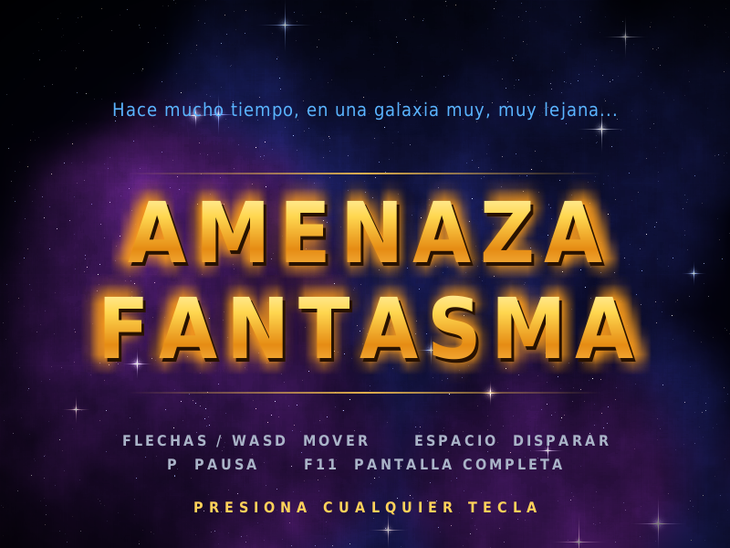
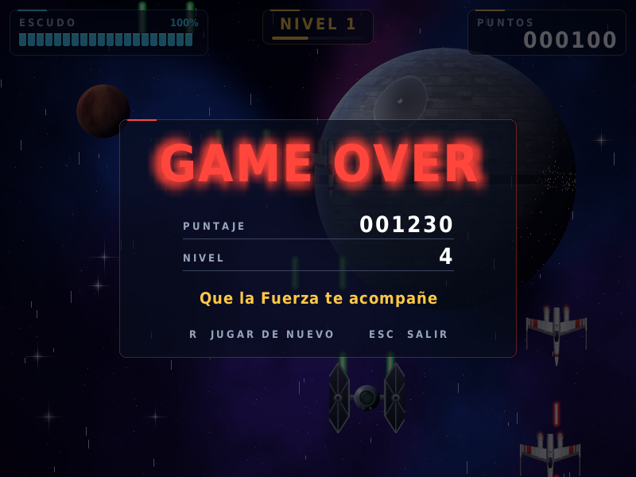

# Amenaza Fantasma

Juego de naves en Python con **pygame**, inspirado en Star Wars. Hecho para la Tecnicatura (Código Crítico, cuarto semestre, Clases 07 a 09).

Manejo un caza TIE y tengo que derribar a los ala-X que bajan disparando. Cada 250 puntos subo de nivel: cambia el escenario, los enemigos se vuelven más rápidos y agresivos, y recupero parte del escudo.



| Pantalla de inicio | Game Over |
|---|---|
|  |  |

---

## Cómo ejecutarlo

Necesito **Python 3** y la librería **pygame 2** (lo probé con Python 3.12 y pygame 2.6.1).

### 1. Crear el entorno virtual e instalar pygame (solo la primera vez)

Desde la carpeta `Clase 07-A-B-C Proyecto`:

```bash
python3 -m venv .venv
.venv/bin/pip install pygame
```

En Windows:

```bash
python -m venv .venv
.venv\Scripts\pip install pygame
```

### 2. Jugar

```bash
cd Juego_Tecnicatura
../.venv/bin/python main.py
```

En Windows: `..\.venv\Scripts\python main.py`

También se puede abrir `main.py` en VS Code o PyCharm, elegir el intérprete de `.venv` y darle a *Run*.

---

## Controles

| Tecla | Acción |
|---|---|
| Flechas o W A S D | Mover la nave |
| Espacio (mantener) | Disparar |
| P | Pausa |
| F11 | Pantalla completa |
| Cualquier tecla | Saltear la pantalla de inicio |
| R (en Game Over) | Jugar de nuevo |
| ESC (en Game Over) | Salir |

---

## Reglas del juego

- Cada enemigo derribado suma **10 puntos**.
- Un **láser enemigo** me quita 10 de escudo y un **choque** con una nave me quita 20.
- Después de recibir un golpe tengo **1 segundo de invulnerabilidad** (la nave parpadea).
- Con **250 puntos** subo de nivel: cambia el fondo, recupero 30 de escudo y los enemigos aparecen más seguido, bajan más rápido y disparan más.
- Si el escudo llega a **0**, es Game Over.

---

## Estructura del proyecto

```
Juego_Tecnicatura/
├── main.py              # Archivo principal: ventana, bucle del juego, inicio y Game Over
├── personaje.py         # Clases Personaje, Enemigo, Laser y LaserEnemigo
├── explosiones.py       # Clase Explosion (animación por fotogramas)
├── hud.py               # Interfaz: escudo, puntos, nivel, pausa y Game Over
├── constantes.py        # Tamaño de pantalla y ruta a la carpeta assets
├── generar_assets.py    # Script que crea todas las imágenes y sonidos
├── assets/
│   ├── images/          # Naves, láseres, fondos, explosiones, ícono
│   │   └── inicio/      # Pantalla de inicio (star.png)
│   └── sounds/          # laser.wav, explosion.wav, musica.wav
└── capturas/            # Imágenes para este README
```

---

## Cómo funciona

### El bucle del juego

Todo juego es un bucle que se repite muchas veces por segundo. En `jugar()` (en `main.py`) el bucle corre a **60 FPS** y en cada vuelta hace siempre lo mismo:

1. **Eventos**: reviso si se cerró la ventana o si apreté P o F11.
2. **Controles**: leo el teclado, muevo la nave y disparo.
3. **Enemigos**: los muevo, a veces disparan, y reviso los choques.
4. **Spawn**: con cierta probabilidad aparece un enemigo nuevo arriba.
5. **Animaciones**: avanzo las explosiones y saco las que terminaron.
6. **Nivel**: si llegué a 250 puntos, subo de nivel.
7. **Dibujo**: fondo → estrellas → enemigos → láseres → mi nave → explosiones → interfaz. El orden importa: lo último que se dibuja queda arriba.
8. **Mostrar**: `presentar()` muestra el frame y `clock.tick(60)` espera para mantener los 60 FPS.

### Programación Orientada a Objetos

Cada cosa que se mueve es un **objeto** con sus **atributos** (posición, imagen, velocidad) y sus **métodos** (`mover()`, `dibujar()`):

| Clase | Archivo | Qué hace |
|---|---|---|
| `Personaje` | personaje.py | Mi nave: se mueve, dispara con cooldown, recibe daño y parpadea al ser golpeada |
| `Enemigo` | personaje.py | Baja, rebota en los bordes y dispara; su dificultad depende del nivel |
| `Laser` | personaje.py | Disparo verde que sube |
| `LaserEnemigo` | personaje.py | **Hereda** de `Laser`: reutiliza `mover()` y `dibujar()`, solo cambia la imagen y la velocidad |
| `Explosion` | explosiones.py | Recorre 9 imágenes para animar la explosión |
| `HUD` | hud.py | Dibuja la interfaz y las pantallas de pausa y Game Over |

### Colisiones

Cada objeto tiene un `rect` (rectángulo) y uso `colliderect()` para saber si dos se tocan. Al rectángulo de mi nave lo achico con `inflate(-30, -30)` porque la imagen tiene bordes vacíos, y así los choques se sienten justos.

Cuando recorro una lista y borro elementos al mismo tiempo, recorro una **copia** (`lista[:]`). Si borro de la misma lista que estoy recorriendo, el `for` se saltea elementos.

### Imágenes precargadas (atributos de clase)

`Explosion`, `Enemigo` y los láseres guardan su imagen en un **atributo de clase** (`imagen_precargada`). La imagen se lee del disco una sola vez y la comparten todos los objetos. Si cada enemigo cargara su imagen, el juego se trabaría cada vez que aparece uno.

### Ventana escalable

El juego siempre se dibuja en un **lienzo de 800×600**. La función `presentar()` lo agranda al tamaño real de la ventana, manteniendo la proporción 4:3. Así la lógica (posiciones, colisiones) no cambia aunque la ventana sea más grande o esté en pantalla completa.

---

## Los assets (imágenes y sonidos)

Todas las imágenes y sonidos los genera el script `generar_assets.py` con código, sin descargar nada, así no hay problemas de derechos de autor. No hace falta correrlo para jugar porque los archivos ya están en `assets/`, pero si cambio algo del diseño los vuelvo a generar con:

```bash
../.venv/bin/python generar_assets.py
```

Tarda unos 15 segundos. Técnicas que usa:

- **Supersampling**: las naves se dibujan a 512 px y se achican a 128. Así los bordes quedan suaves.
- **Degradados con máscaras**: para que las chapas de las naves parezcan de metal.
- **Iluminación 3D por píxel**: los planetas calculan la luz en cada punto con la ley de Lambert, más brillo especular, luz de borde y luces nocturnas.
- **Ruido (value noise)**: manchas al azar suavizadas que forman las nebulosas, las nubes y las texturas de los planetas.
- **Desenfoque**: se achica y se vuelve a agrandar la imagen. Se usa para el brillo de los láseres, el fuego y los textos.
- **Síntesis de sonido**: el láser es una onda senoidal que baja de tono, la explosión es ruido filtrado y la música es una base de acordes en modo menor con pulsos de timbal.

Para usar imágenes o sonidos propios, reemplazo el archivo en `assets/` con **el mismo nombre**.

---

## Problemas comunes

| Problema | Solución |
|---|---|
| `ModuleNotFoundError: No module named 'pygame'` | Estoy usando un Python sin pygame. Ejecutar con `../.venv/bin/python` o instalar pygame en el entorno. |
| `FileNotFoundError` con algún archivo de `assets` | Falta la carpeta de assets: correr `generar_assets.py`. |
| No se escucha nada | Revisar el volumen del sistema. Los volúmenes del juego se ajustan en `main()` con `set_volume()`. |
| La fuente de la interfaz se ve distinta | El juego usa Bahnschrift (Windows) o DejaVu (Linux). Si no están, usa otra fuente del sistema. |

---

## Temas de las clases aplicados

- **8.x** Clases, funciones, instancias y atributos (`Personaje`, `Enemigo`, `Explosion`).
- **9.1** Energía del personaje: escudo, daño, invulnerabilidad y barra en el HUD.
- **9.2** Armas y movimiento: disparo doble con cooldown, límites de pantalla y WASD.
- **9.3** Sonidos: efectos con `pygame.mixer.Sound` y música con `pygame.mixer.music`.
- **9.4 / 9.5** Movimientos del enemigo: velocidad aleatoria, rebote en los bordes y disparos.
- **9.6** Importar y configurar: módulos separados (`personaje`, `explosiones`, `hud`, `constantes`).
- **9.7** Juego terminado: niveles, pausa, Game Over y reinicio.

---

Autor: **Ariel Mazara**, Tecnicatura, Código Crítico, 2026.
